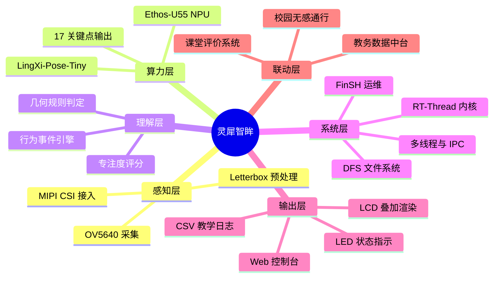
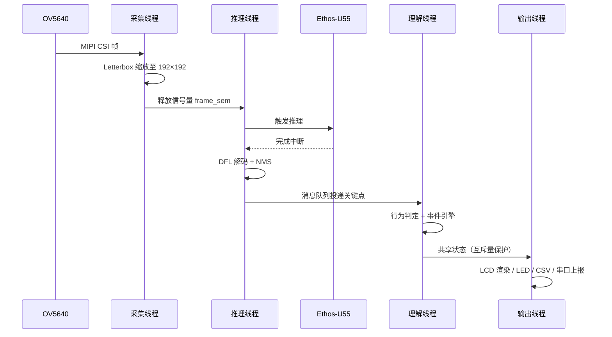
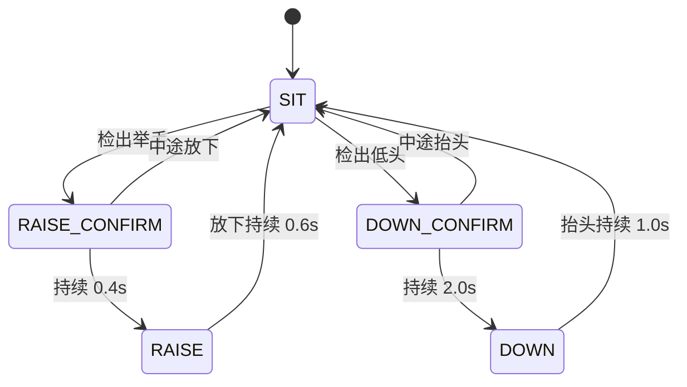
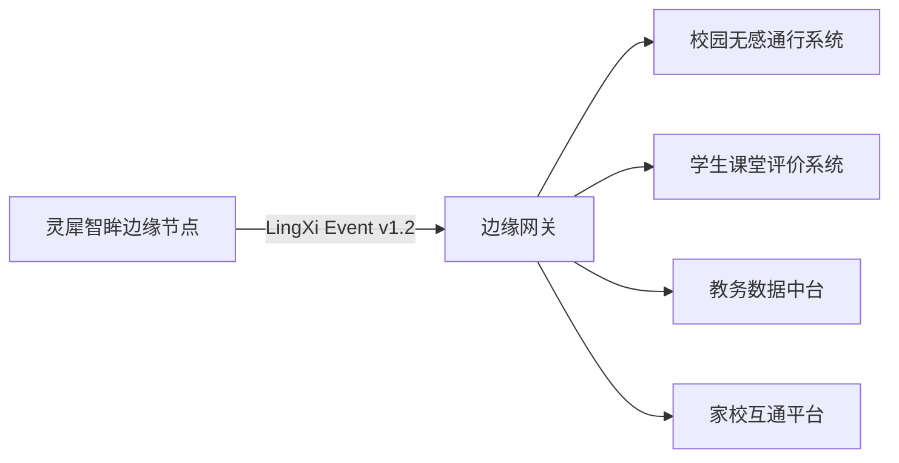

# 灵犀智眸 LingXi Vision

## 基于 RT-Thread 与瑞萨 RA8P1 边缘 AI 的学生课堂行为智能监测系统

> 2026 RT-Thread 嵌入式大赛参赛作品  
> 硬件平台：RT-Thread × Renesas RA8P1 Titan Board Mini  
> 文档版本：v2.1

---

## 摘要

课堂行为监测的既有方案普遍依赖"摄像头采集 + 云端推理"架构，其规模化落地的阻碍并不在算法精度，而在数据合规与部署成本：课堂影像上云涉及未成年人隐私审批，单教室工控机方案则难以被普通学校接受。

本项目提出并实现了一种端侧闭环方案：在 Cortex-M85 + Ethos-U55 NPU 的微控制器平台上完成从图像采集、姿态推理到行为理解的全链路处理，原始帧不出设备，对外仅输出结构化行为事件。系统基于 RT-Thread 实时操作系统构建，实测在 QVGA 输入下稳定达到 20~22 FPS。

**关键词**：RT-Thread；RA8P1；Ethos-U55；姿态估计；边缘推理；课堂行为分析；隐私计算

---

## 目录

1. 需求分析与设计约束
2. 系统总体设计
3. 硬件平台与选型论证
4. RT-Thread 系统层设计
5. 端侧 AI 推理链路
6. 课堂行为理解算法
7. 行为事件引擎
8. 课堂专注度评分模型
9. 数据契约与校园信息化联动
10. 性能测试与分析
11. 可靠性、实时性与合规设计
12. 创新点与技术路线图
- 附录 ：核心参数表

---

## 1. 需求分析与设计约束

### 1.1 应用场景与痛点

| 痛点          | 具体表现                     | 现有方案的不足      |
| ----------- | ------------------------ | ------------ |
| 教师注意力带宽有限   | 课堂单人难以持续覆盖后排与边缘区域状态      | 依赖巡堂，主观性强    |
| 过程性评价缺乏客观依据 | 期末评语与平时分主要依赖记忆与印象        | 无量化数据支撑      |
| 视频监控方案落地困难  | 课堂影像上云，涉及未成年人隐私审批        | 合规风险高，家长接受度低 |
| 部署成本        | 教室环境不具备为单节课配备工控机与独立显卡的条件 | 成本与运维压力      |

### 1.2 设计约束

项目立项时明确四条约束，后续全部技术选型均由此推导：

| 编号  | 约束             | 对设计的直接影响                        |
| --- | -------------- | ------------------------------- |
| C1  | 原始图像不出设备       | 排除云端推理；推理完成即释放帧缓冲；对外仅输出结构化数据    |
| C2  | 单教室成本可控        | 排除 Linux 工控机方案，必须采用 MCU 级平台     |
| C3  | 端到端实时（≥15 FPS） | 模型必须量化为 INT8 并交由 NPU 执行；算法复杂度受限 |
| C4  | 可离线独立运行        | 网络仅作为可选扩展通道，不参与主流程              |

需要说明，C1 与 C2 共同决定了本方案在算力上的上限：部分复杂的时序行为识别（如长时间注意力轨迹建模）在当前平台上无法实现，这属于主动接受的取舍，而非技术缺陷。

---

## 2. 系统总体设计

### 2.1 系统思维导图



### 2.2 分层架构

```
┌────────────────────────────────────────────────────────────┐
│  应用层    课堂业务逻辑                                       │
│            行为判定 · 事件引擎 · 专注度评分 · 教学日志          │
├────────────────────────────────────────────────────────────┤
│  AI 层     LingXi-Pose-Tiny（INT8）· Ethos-U55 NPU 驱动      │
│            DFL 框回归解码 · 关键点热图解码 · NMS               │
├────────────────────────────────────────────────────────────┤
│  系统层    RT-Thread 5.x                                     │
│            线程调度 · IPC · 内存管理 · DFS/elm-FAT · FinSH     │
├────────────────────────────────────────────────────────────┤
│  驱动层    设备驱动框架（统一抽象）                            │
│            Camera(CSI) · NPU · SDIO · LCD · GPIO · USB CDC    │
├────────────────────────────────────────────────────────────┤
│  硬件层    RA8P1：Cortex-M85 @1GHz + Cortex-M33 @250MHz       │
│            Ethos-U55 NPU · 32MB SDRAM · OV5640 · RGB LCD      │
└────────────────────────────────────────────────────────────┘
```

分层的关键收益在于可替换性：调试阶段更换摄像头型号时，应用层代码无需改动，仅需保证驱动注册的设备名一致。

### 2.3 数据流时序



从采集到画面刷新，端到端延迟实测 40~50 ms。

---

## 3. 硬件平台与选型论证

### 3.1 平台规格

| 项目   | 规格                                                                |
| ---- | ----------------------------------------------------------------- |
| 开发板  | RT-Thread × Renesas Titan Board Mini                              |
| 主控   | R7KA8P1KFLCAC：Cortex-M85 @1GHz（含 Helium 矢量扩展）+ Cortex-M33 @250MHz |
| NPU  | Arm Ethos-U55 @500MHz，INT8 定点加速                                   |
| 片上存储 | 2 MB SRAM + 1 MB MRAM                                             |
| 板载存储 | 32 MB SDRAM + 8 MB QSPI Flash + microSD 卡槽                        |
| 摄像头  | OV5640，MIPI CSI 接口                                                |
| 显示   | RGB 并行 LCD，GLCDC 控制器 + D/AVE 2D 图形加速                              |
| 外设   | USB 2.0 HS（CDC / MSC）、以太网 PHY、三色 LED、LSM6DS3 六轴 IMU               |

### 3.2 MCU + NPU 与 Linux 平台的对比

| 维度    | MCU + NPU（本方案） | Linux 工控机 + 加速卡 |
| ----- | -------------- | --------------- |
| 单教室成本 | 数百元量级          | 数千元量级           |
| 整机功耗  | 瓦级以下           | 十余瓦至数十瓦         |
| 启动时间  | 秒级             | 数十秒             |
| 运维需求  | 近似为零，故障时可整板更换  | 需系统维护与升级管理      |
| 数据合规  | 原始数据物理上不离开芯片   | 依赖软件与管理制度约束     |
| 安装方式  | 挂壁 / 磁吸        | 需机柜或支架          |

代价同样明确：算力受限，模型规模必须压缩，复杂时序建模能力有限。考虑到课堂行为检测的核心需求是"人体姿态的几何关系判定"，而非语义级理解，该代价在可接受范围内。

---

## 4. RT-Thread 系统层设计

嵌入式 AI 系统的工程稳定性主要由操作系统层决定。本章说明 RT-Thread 在本项目中的实际使用方式，而非仅作为运行环境被"移植"。

### 4.1 线程划分与优先级规划

系统拆分为六个线程，优先级按"距离硬件时序越近、优先级越高"的原则排列：

| 线程            | 优先级 | 栈大小  | 职责                 | 优先级依据             |
| ------------- | --- | ---- | ------------------ | ----------------- |
| `cam_capture` | 6   | 4 KB | CSI 采集、预处理、帧缓冲管理   | 受硬件时序约束，帧到达未取即丢失  |
| `npu_infer`   | 8   | 8 KB | 触发 NPU、等待完成中断、解码输出 | 需在下一帧到达前完成解码      |
| `behavior`    | 12  | 6 KB | 行为判定、事件引擎、专注度计算    | 计算密集，但容许单帧延迟      |
| `render`      | 18  | 4 KB | LCD 叠加渲染（框、骨架、OSD） | 人眼对 100 ms 级差异不敏感 |
| `report`      | 20  | 4 KB | 串口上报、LED 状态控制      | 允许延迟与丢弃           |
| `logger`      | 22  | 4 KB | CSV 日志落盘           | SD 卡写入可能阻塞，优先级最低  |

线程采用静态方式创建，启动时一次性初始化：

```c
static struct rt_thread thread_infer;
static rt_uint8_t infer_stack[8192];

rt_thread_init(&thread_infer, "npu_infer", npu_infer_entry, RT_NULL,
               infer_stack, sizeof(infer_stack), 8, 10);
rt_thread_startup(&thread_infer);
```

### 4.2 线程间通信机制

不同数据类型采用不同 IPC 机制，避免用单一手段覆盖全部场景：

| 场景          | 机制               | 选择理由                 |
| ----------- | ---------------- | -------------------- |
| 采集完成 → 启动推理 | 信号量 `frame_sem`  | 纯同步，无数据传递，信号量开销最小    |
| 推理结果 → 行为判定 | 消息队列 `kp_mq`     | 需传递关键点数组，队列缓冲可吸收推理抖动 |
| 全局状态读写      | 互斥量 `state_lock` | 检测结果被渲染与上报线程并发读取     |
| 告警类事件通知     | 邮箱 `evt_mb`      | 数据量小但要求及时，邮箱开销低于队列   |

```c
/* 采集线程：帧就绪 */
rt_sem_release(frame_sem);

/* 推理线程：带超时等待，避免死等 */
if (rt_sem_take(frame_sem, RT_TICK_PER_SECOND / 10) != RT_EOK) {
    continue;   /* 超时重试，不阻塞流水线 */
}
```

**关键设计点**：所有 IPC 等待均设置超时。早期版本采用无限等待，实测在 SD 卡接触不良时日志线程阻塞会沿调用链扩散，导致整条流水线停摆；改为超时重试后，单点故障不再扩散。

### 4.3 文件系统与教学数据沉淀

CSV 教学日志基于 DFS + elm-FAT 组件实现，SD 卡挂载至根 `/`：

```c
dfs_mount("sd0", "/", "elm", 0, 0);

int fd = open("/classroom_log.csv", O_WRONLY | O_CREAT | O_APPEND);
if (fd >= 0) {
    write(fd, line, strlen(line));
    close(fd);
}
```

日志格式：

```csv
timestamp,event,people,confidence
1762000042,RAISE,1,0.88
1762000087,DOWN_ALERT,1,0.91
```

选用 CSV 而非嵌入式数据库的直接原因是使用端成本：教师课后使用 Excel 即可直接打开，无需额外工具链。

### 4.4 设备驱动框架

摄像头、SD 卡、LCD、GPIO 统一通过 RT-Thread 设备驱动框架访问：

```c
rt_device_t cam = rt_device_find("camera");
rt_device_open(cam, RT_DEVICE_FLAG_RDONLY);
rt_device_read(cam, 0, frame_buf, frame_size);
```

该抽象带来的工程收益在硬件迭代阶段体现明显：更换摄像头型号后应用层零改动，仅需保证驱动注册的设备名一致。

### 4.5 FinSH 在线观测

开发过程中使用 FinSH 控制台观测运行时状态，其中 `list_thread` 的栈峰值统计对栈容量配置起到了决定性作用：

```
msh />list_thread
thread   pri  status      sp     stack size max used left tick  error
-------- ---  ------- ---------- ---------- ------ ---------- ---
cam_cap    6  suspend 0x000000a8 0x00001000    28%   0x00000005 000
npu_inf    8  suspend 0x00000010 0x00002000    46%   0x0000000a 000
behav     12  running 0x000000c0 0x00001800    35%   0x00000003 000
render    18  suspend 0x00000090 0x00001000    22%   0x00000001 000
report    20  suspend 0x00000088 0x00001000    19%   0x00000002 000
logger    22  suspend 0x000000a0 0x00001000    31%   0x00000004 000
```

推理线程最初配置 4 KB 栈，实测在 8 KB 栈上峰值为 46%（约 3.7 KB），已逼近 4 KB 上限。此类问题若不通过工具观测，其表现为随机死机，定位成本极高。

```
msh />list_device
device           type         ref count
-------- -------------------- ----------
camera   Character Device     1
sd0      Block Device         1
lcd      Graphic Device       1
uart1    Character Device     2
```

### 4.6 RT-Thread 组件使用情况

| 组件                   | 用途                    |
| -------------------- | --------------------- |
| 内核                   | 多线程调度、信号量、互斥量、消息队列、邮箱 |
| DFS + elm-FAT        | SD 卡文件系统与 CSV 日志      |
| 设备驱动框架               | 外设统一抽象                |
| FinSH / msh          | 在线调试与运行时观测            |
| libc                 | 标准 C 库                |
| OpenMV / MicroPython | 应用层行为逻辑实现             |

关于最后一项需作说明：**内核层为 RT-Thread 原生实现，应用层业务逻辑采用 MicroPython**。该划分的原因是行为判定规则涉及频繁调参（阈值、持续时间），以脚本形式部署可避免每次修改重新编译固件；而调度、同步、存储等实时性相关部分仍由内核保证。

---

## 5. 端侧 AI 推理链路

### 5.1 模型设计

模型命名为 **LingXi-Pose-Tiny**，其基座为通用多人姿态估计架构，面向 MCU 部署进行了两项改造：

| 步骤   | 方法                                  | 目的                           |
| ---- | ----------------------------------- | ---------------------------- |
| 结构裁剪 | 按 Ethos-U55 算子支持度与内存带宽重排通道数，替换不友好算子 | 使全部算子可由 NPU 硬件执行，避免回退到 CPU   |
| 知识蒸馏 | 以全精度姿态模型为教师网络，关键点热图对齐蒸馏             | 在小模型容量下维持关键点定位精度，尤其针对课堂坐姿类姿态 |
| 量化部署 | INT8 per-tensor 定点量化                | 匹配 NPU 定点计算单元                |

最终模型输入固定为 192×192×3，体积约 2.13 MB，存放于 SD 卡。

输入分辨率的选取依据实测：低于 192 时关键点抖动明显加剧；高于 192 时帧率下降至 15 FPS 以下，课堂场景的实时体验受损。

### 5.2 输出解码：DFL 与 NMS

模型输出包含分布 focal loss（DFL）形式的框回归与关键点热图，需自行解码。以下实现中的常量与模型导出配置严格对应：

```python
def _decode_pose(self, out):
    # DFL：对每条边的 16 个 bin 做 softmax 加权求和
    boxes  = self._dist2bbox(out[0, :, :64], self.anchors)
    scores = out[0, :, 64:65]
    kpts   = out[0, :, 65:].reshape(-1, 17, 3)

    # 置信度过滤 + 类别无关 NMS
    keep = nms(boxes, scores, iou_thr=0.45)
    return boxes[keep], scores[keep], kpts[keep]
```

NMS 采用类别无关版本（画面中仅存在"人"单一类别）。IoU 阈值 0.45 由实测确定：阈值过低会将并排就座的两人合并为单一目标，过高则产生重复框。

### 5.3 坐标还原与几何保真

模型输出坐标基于 192×192 输入网格，需映射至显示分辨率：

```python
sx = DISPLAY_W / MODEL_IN_W
sy = DISPLAY_H / MODEL_IN_H
for k in keypoints:
    k.x *= sx
    k.y *= sy
```

此处需特别注意：摄像头成像分辨率与 LCD 显示分辨率通常非等比关系，直接拉伸会导致画面形变并使判定阈值系统性偏移。实现中采用等比缩放 + 居中裁剪（letterbox），保证人体比例不失真。

---

## 6. 课堂行为理解算法

### 6.1 方法选择：关键点估计 + 几何规则

初期尝试过端到端的"课堂行为分类器"，自建数百张标注样本，效果不佳：趴桌与低头在部分视角下特征高度重合，举手与伸展动作难以区分，且数据收集成本远超预期。

最终采用两段式方案：**模型仅负责关键点定位精度，行为判定交由几何规则完成**。其优势在于：

- 规则可读可调，需求变更（如提高趴桌灵敏度）仅涉及常数修改，无需重新训练；
- 判定过程可解释，可明确指出触发判定所依据的关键点；
- 不依赖任何行为类别的训练数据。

### 6.2 个体差异归一化

不同学生与摄像头的距离差异导致相同动作的像素位移相差数倍，绝对像素阈值不可用。系统采用**个体自身尺度**作为归一化基准：

```python
# 躯干长度作为该个体的尺度基准
torso      = dist(keypoints['neck'], keypoints['hip_center'])
# 肩线作为参考水平线
shoulder_y = (keypoints['l_shoulder'].y + keypoints['r_shoulder'].y) / 2
```

全部判定阈值均以 `torso` 的倍数表达，使前排与后排学生共用同一套参数。

### 6.3 四类行为判定规则

| 行为         | 判定条件                                       | 附加约束           |
| ---------- | ------------------------------------------ | -------------- |
| 举手发言 RAISE | 手腕 y 低于肩线 y，差值 > 0.30 × torso              | 单手触发，取左右手中较优者  |
| 低头/趴桌 DOWN | 鼻子 y 高于肩线 y，差值 > 0.35 × torso              | 头部关键点置信度 > 0.5 |
| 站立 STAND   | 目标框高度 > 0.60 × 画面高，且髋-踝纵向展开 > 1.20 × torso | —              |
| 坐姿端正 SIT   | 上述条件均不满足                                   | 默认态            |

```python
def classify(kp, box_h, frame_h):
    torso = dist(kp['neck'], kp['hip_center'])
    sh_y  = (kp['l_shoulder'].y + kp['r_shoulder'].y) / 2

    if min(kp['l_wrist'].y, kp['r_wrist'].y) < sh_y - 0.30 * torso:
        return 'RAISE'
    if kp['nose'].y > sh_y + 0.35 * torso and kp['nose'].conf > 0.5:
        return 'DOWN'
    if box_h > 0.60 * frame_h and (kp['ankle'].y - kp['hip'].y) > 1.20 * torso:
        return 'STAND'
    return 'SIT'
```

### 6.4 判定优先级与仲裁

多条件同时满足时（如站立并举手），按下述优先级仲裁：

```
RAISE  >  DOWN  >  STAND  >  SIT
```

设定依据：举手为最强交互信号，优先保证召回；趴桌属需干预的负面状态次之；站立通常为过渡姿态；坐姿作为兜底类别。

---

## 7. 行为事件引擎

### 7.1 问题：逐帧判定的抖动

初版将逐帧判定结果直接呈现，计数不稳定：模型在决策边界处来回跳变，同一目标每秒在"坐姿"与"趴桌"间切换多次，计数器迅速累积至无意义量级。

该问题的根源并非模型精度，而是将逐帧瞬时输出直接等同于行为事件。

### 7.2 状态机设计

为每个跟踪目标引入带时间确认与滞回（hysteresis）的状态机：



设计要点有二：状态迁移需持续满足一定时长方被确认；进入与退出的时间阈值不同（滞回），避免边界处反复切换。

### 7.3 时间参数设定

| 参数                 | 取值   | 依据                                  |
| ------------------ | ---- | ----------------------------------- |
| `RAISE_CONFIRM_MS` | 400  | 真实举手动作通常持续 1s 以上，400 ms 可滤除抖动且响应不迟钝 |
| `RAISE_RELEASE_MS` | 600  | 放下手臂过程存在"半举"中间态，滞回防止抖动              |
| `DOWN_CONFIRM_MS`  | 2000 | 短暂低头（记笔记）不应触发告警，2s 依据教学实际场景确定       |
| `DOWN_RELEASE_MS`  | 1000 | 抬头后延迟解除，避免频繁告警                      |

### 7.4 核心实现

```python
class BehaviorTracker:
    def update(self, tid, label, now):
        st = self.state.get(tid)
        if st is None:
            self.state[tid] = {'cur': label, 'cand': None, 't0': now}
            return None

        if label == st['cur']:
            st['cand'] = None                      # 回到当前状态，取消候选
            return None

        if st['cand'] != label:
            st['cand'] = label                     # 新候选，开始计时
            st['t0']   = now
            return None

        if now - st['t0'] > self.confirm_ms[label]:
            old, st['cur'] = st['cur'], label      # 确认迁移
            st['cand'] = None
            return (old, label)
        return None
```

`update()` 返回的是**状态迁移边沿**而非当前状态，仅在真正发生切换的时刻产出事件。上层据此进行计数、写日志与控制 LED，使系统输出的统计数字具备实际意义。

---

## 8. 课堂专注度评分模型

### 8.1 评分定义

需明确该指标的定位：**它是面向教师的教学参考量，而非针对学生的评价分数**，仅反映当前时刻课堂整体状态。

```
focus_raw = 100 × (1.00 × n_sit + 0.85 × n_raise) / (n_sit + n_raise + n_down + 0.5 × n_stand)
```

权重设定依据：

- 举手虽不属于"听讲"，但表征参与度，赋予 0.85 权重而非计为 0；
- 站立状态（走动、上讲台等）按 0.5 计入分母，避免个别走动显著拉低整体分数；
- 趴桌不计入分子，直接拉低分值。

随后进行指数平滑（时间常数约 3~5 s）：

```python
focus = 0.7 * focus_prev + 0.3 * focus_raw
```

### 8.2 分级呈现

| 分值区间    | 颜色  | 含义     |
| ------- | --- | ------ |
| ≥ 80    | 绿   | 状态良好   |
| 60 ~ 79 | 黄   | 出现分散迹象 |
| < 60    | 红   | 建议干预   |

板端 LCD 与 Web 控制台同步显示，红色区间时联动点亮告警 LED。

---

## 9. 数据契约与校园信息化联动

本章阐述系统接入校园信息化体系时的接口设计。目前已实现数据契约本身；与具体业务系统的对接依赖校方开放相应接口，属于规划范畴。

### 9.1 设计原则

**仅输出结构化事件，不输出图像，不输出身份信息。**

系统不具备也不需要提供身份识别能力，其输出仅为"画面中存在若干人、各处于何种状态"。该原则既确立隐私底线，也降低了对接方的数据审批阻力。

### 9.2 联动架构



### 9.3 联动场景一：校园无感通行系统

通行系统可记录学生进入教学楼，但无法确认是否进入课堂。两类数据源按课表时间对齐、以班级为粒度交叉核验：

| 通行系统记录 | 本系统实测 | 判定             |
| ------ | ----- | -------------- |
| 已刷卡入校  | 实测到课  | 正常             |
| 已刷卡入校  | 未检出   | 刷卡后未到课，提示辅导员关注 |
| 未刷卡    | 实测到课  | 通行记录异常，建议核验设备  |

该比对以班级人数为单位，不涉及任何个体身份信息。

### 9.4 联动场景二：学生课堂评价学习系统

过程性评价可基于系统输出的三类指标构建：

```
过程性评价得分 = 0.4 × 专注度均值 + 0.4 × 互动得分 + 0.2 × 出勤得分
```

其中互动得分由举手发言次数归一化得到，出勤得分由课堂实测到课率给出。相较期末一次性评定，跨学期趋势曲线更具参考价值。

### 9.5 统一数据契约

```json
{
  "schema": "LingXiBehaviorEvent/v1.2",
  "device_id": "RA8P1-CLASSROOM-01",
  "class_id": "G2024-CS-03",
  "session": "2026-11-01-P3",
  "ts": 1762000000,
  "metrics": {
    "people_count": 42,
    "focus_score": 87,
    "raise_total": 23,
    "down_alerts": 2
  },
  "events": [
    { "type": "RAISE",      "ts": 1762000042, "duration_ms": 1200, "confidence": 0.88 },
    { "type": "DOWN_ALERT", "ts": 1762000087, "duration_ms": 3400, "confidence": 0.91 }
  ],
  "privacy": { "contains_image": false, "contains_identity": false }
}
```

`privacy` 字段供下游系统以程序化方式确认数据不含敏感内容，降低合规审查成本。

### 9.6 传输设计

- 协议：MQTT，主题层级 `school/{school_id}/classroom/{class_id}/behavior`
- 服务质量：QoS 1，保证至少一次送达
- 断网处理：边缘节点本地缓存，网络恢复后补传
- 上报粒度：教室级聚合，默认周期 30 s（非逐帧上传）

---

## 10. 性能测试与分析

### 10.1 端侧性能

| 指标     | 实测值         | 测试条件               |
| ------ | ----------- | ------------------ |
| 推理帧率   | 20 ~ 22 FPS | QVGA 采集，192×192 输入 |
| 单帧推理耗时 | 38 ~ 46 ms  | 含解码与后处理            |
| 单帧人数上限 | 10 人        | 模型设计上限             |
| 端到端延迟  | < 50 ms     | 采集至 LCD 刷新         |

### 10.2 行为判定实测

测试为单一受试者在镜头前完成的验证性实验，样本量有限，结论仅用于可行性说明：

| 行为  | 测试次数     | 正确  | 主要误判情形             |
| --- | -------- | --- | ------------------ |
| 举手  | 30       | 28  | 伸展动作误判为举手（2 次）     |
| 趴桌  | 20       | 19  | 弯腰拾物误报（1 次）        |
| 站立  | 15       | 14  | 前排站立目标被画面边缘截断（1 次） |
| 坐姿  | 连续 5 min | 稳定  | 无明显误判              |

误判来源为姿态本身的语义歧义，而非关键点定位误差。进一步改善需引入多帧轨迹信息，已列入后续工作。

### 10.3 资源占用

| 资源              | 占用情况             |
| --------------- | ---------------- |
| CPU（Cortex-M85） | 约 52%            |
| NPU             | 约 68%            |
| SDRAM           | 13.1 / 32 MB     |
| 线程栈峰值           | 推理线程 46%（8 KB 栈） |
| 日志体积            | 约 2 KB / 课时      |

---

## 11. 可靠性、实时性与合规设计

### 11.1 可靠性

- 所有 IPC 等待均设超时，单线程阻塞不扩散至整条流水线；
- SD 卡写入失败不影响检测主流程，仅丢失日志；
- 模型加载失败时降级为"仅人数统计"模式，而非终止运行；
- 连续运行 2 小时无重启，经 FinSH `free` 命令确认无内存持续增长。

### 11.2 实时性

- 采集线程优先级最高，避免丢帧；
- NPU 推理采用中断回调，无轮询空转；
- 渲染线程检测到新帧到达时丢弃旧帧，不做队列堆积。

### 11.3 合规设计

| 措施         | 说明                         |
| ---------- | -------------------------- |
| 原始帧不出设备    | 推理完成后立即释放缓冲区，无图像落盘或上传      |
| 不具备身份识别能力  | 系统无人脸比对功能，输出无法关联至具体学生      |
| 对外仅输出结构化数值 | 串口与网络输出仅含人数、行为计数、专注度评分     |
| 本地存储可关闭    | CSV 日志功能可关闭，关闭后系统不留存任何历史数据 |
| 安装位置可控     | 建议摄像头覆盖座位区域，避开讲台与休息区       |

---

## 12. 创新点与技术路线图

### 12.1 主要创新点

1. **端侧闭环的课堂行为理解架构**。采集、推理、理解、输出全链路在 MCU 上完成，原始图像不出设备，从架构层面而非管理层面解决隐私问题。

2. **几何规则与带滞回时间状态机相结合的行为判定方法**。模型专注关键点定位精度，行为语义由可读规则判定；时间确认与滞回机制消化逐帧抖动，使系统在无行为类别训练数据的前提下即可投入实用。

3. **基于个体尺度的归一化判定**。以每个目标自身躯干长度作为基准，解决前后排距离差异导致的阈值失效问题，是方案能否实际部署于真实教室的关键细节。

4. **RT-Thread 内核能力的工程化使用**。六线程优先级规划、四类 IPC 分工、DFS 日志落盘、FinSH 栈峰值观测，均用于解决实际的调度与可靠性问题，而非仅作为运行环境。

5. **面向校园信息化的隐私友好数据契约**。仅输出结构化事件并内置隐私声明字段，使对接学校既有系统在技术实现与合规审批两个维度均具备可行性。

### 12.2 后续工作

| 方向   | 内容                              |
| ---- | ------------------------------- |
| 通信能力 | 启用板载以太网，实现浏览器直连的 Web 控制台，省去串口中转 |
| 算法增强 | 引入多帧轨迹信息，解决举手与伸展等姿态语义歧义         |
| 设备自检 | 利用 LSM6DS3 IMU 实现设备防拆与安装角度自检    |
| 数据积累 | 开展多班级实地采集，将阈值由人工标定转为数据驱动标定      |
| 系统对接 | 推进与校园既有信息系统的实际对接，验证第 9 章设计      |

---

## 附录：核心参数表

| 参数                   | 默认值           | 说明         |
| -------------------- | ------------- | ---------- |
| `MODEL_INPUT`        | 192 × 192 × 3 | 模型输入分辨率    |
| `MAX_PEOPLE`         | 10            | 单帧最大检测人数   |
| `CONF_THRES`         | 0.55          | 目标框置信度阈值   |
| `IOU_THRES`          | 0.45          | NMS IoU 阈值 |
| `RAISE_RATIO`        | 0.30 × torso  | 举手判定阈值     |
| `DOWN_RATIO`         | 0.35 × torso  | 低头判定阈值     |
| `STAND_BOX_RATIO`    | 0.60 × 画面高    | 站立判定阈值     |
| `RAISE_CONFIRM_MS`   | 400           | 举手事件确认时长   |
| `RAISE_RELEASE_MS`   | 600           | 举手事件解除时长   |
| `DOWN_CONFIRM_MS`    | 2000          | 趴桌告警确认时长   |
| `DOWN_RELEASE_MS`    | 1000          | 趴桌告警解除时长   |
| `FOCUS_EMA`          | 0.7 / 0.3     | 专注度指数平滑系数  |
| `REPORT_INTERVAL_MS` | 500           | 串口上报周期     |
